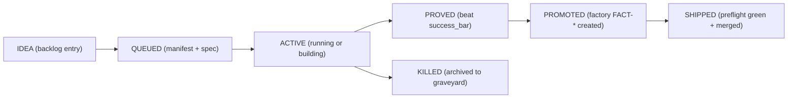

# Caelus R&D Lab and Feature Factory Charter

This document defines the durable operating model for `lab/` in the Caelus
monorepo. Any future Antigravity session
discovers this institution automatically via `.agents/skills/caelus-lab/`,
`.agents/skills/caelus-factory/`, and the directory rule `lab/AGENTS.md`.

## Two-Track Architecture

The workspace separates speculative research from production delivery into two
coupled tracks with distinct rules and blast radii.

| Track | Location | Goal | Production Touch | Gate |
|---|---|---|---|---|
| **Track A: R&D Lab** | `lab/experiments/`, `lab/graveyard/` | Test hypotheses quickly against trivial baselines; prove or kill | None (read-only imports from `packages/caelus/dist/` and `python/astroengine/`) | Caelus Razor (`manifest.json` + reproducible `results.json`) |
| **Track B: Feature Factory** | `lab/factory/` | Ship proved winners and `ROADMAP.md` milestones cleanly | Isolated feature branch (`feat/<slug>`) across `python/`, `packages/`, `apps/`, `docs/` | 5-stage assembly line + independent `verifier` + `npm run preflight` |

### Track A: R&D Lab

Track A answers one empirical question per experiment: does Caelus's
deterministic geocentric physics, ephemeris precision, or provenance layer beat
a trivial baseline (`Date.now()`, fixed sinusoids, `sha256`, or semantic+LRU)
by a pre-registered margin?

- Every experiment lives in its own folder `lab/experiments/EXP-NNN-<slug>/`
  with `manifest.json`, `README.md`, an executable benchmark (`experiment.mjs`
  or `experiment.py`), and a generated `results.json` receipt.
- Dead ends are documented immediately in `lab/graveyard/KILL-NNN-<slug>.md`
  with exact measured evidence so future sessions never repeat them.

### Track B: Feature Factory

Track B turns proved R&D outcomes and planned `ROADMAP.md` items into release-
grade Caelus features.

- Every factory item lives in `lab/factory/FACT-NNN-<slug>/` with
  `manifest.json` and a detailed `SPEC.md` listing exact target files,
  invariants, promotion gates, and verification commands.
- Execution follows the 5-stage assembly line in
  `.agents/skills/caelus-factory/SKILL.md`:
  0. Spec, gate check, and branch isolation
  1. Reference-first Python implementation + golden fixture
  2. Zero-dependency TypeScript core port + parity/latency benchmark
  3. Node-free MCP surface, Workbench widgets/instruments, editorial docs, and
     facts/claims sync
  4. Independent adversarial verifier + full `npm run preflight`

## Lifecycle States

Every item in `lab/experiments/` and `lab/factory/` carries a `status` field
that moves strictly through this state machine:



| State | Meaning | Required Evidence |
|---|---|---|
| `idea` | Recorded candidate in `lab/BACKLOG.md` | Problem statement and proposed baseline |
| `queued` | Folder and `manifest.json` exist; waiting for execution or upstream gate | Complete Razor fields or `SPEC.md` |
| `active` | Currently being researched or built on a branch | Assigned owner or active session |
| `proved` | Met `success_bar` against `null_baseline` (or Factory Stage 4 green awaiting merge) | Fresh `results.json` with `status: "pass"` |
| `promoted` | R&D experiment graduated to a `FACT-NNN` spec in `lab/factory/` | Linked `FACT-NNN` directory |
| `shipped` | Merged into production branch with full preflight receipt | Preflight pass + `ROADMAP.md` / `CHANGELOG.md` update |
| `killed` | Hit `kill_criterion` or beaten/tied by null baseline | `lab/graveyard/KILL-NNN-*.md` postmortem |

## Core Engineering Boundary

Consistent with `ROADMAP.md`, Caelus core remains strictly computational and
interpretation-free. R&D experiments may probe novel agent-native interfaces
(temporal grounding, episodic memory indexing, spacetime observation forensics,
neural positional encodings), and any feature promoted into `caelus` or
`caelus-mcp` must be verifiable against physical law, a published mathematical
algorithm, or a named external oracle (JPL Horizons, Swiss Ephemeris, or cited
classical tables).

## Invocation Modes

### 1. On Demand (Single Session)

Activate the `caelus-lab` or `caelus-factory` skill and run:

```bash
node lab/scripts/lab.mjs status
```

Select the highest-priority `queued` or `active` item from `lab/BACKLOG.md`,
execute its workflow, and regenerate `lab/LEDGER.md`.

### 2. Parallel Swarm (`/swarm`)

Spin up isolated workers with disjoint directory ownership:
- **R&D Sprint**: `lab-researcher-*` workers own distinct `EXP-NNN-*` folders;
  `lab-architect` owns `lab/LEDGER.md`, `lab/BACKLOG.md`, `lab/graveyard/`, and
  `lab/factory/`.
- **Factory Run**: `python-ref -> ts-engine -> mcp-and-docs / widget-builder -> verifier`
  passing peer-to-peer `[done]` handoffs on a dedicated feature branch.

### 3. Overnight Long-Horizon (`/goal`)

Point `/goal` at a multi-iteration objective, such as running an external LLM
evaluation pass over `EXP-001/eval_suite.jsonl` and `EXP-003/vlm_eval_pack.jsonl`,
or driving a `FACT-*` spec end-to-end from Stage 0 through a green Stage 4
preflight. Always state explicit termination gates in the goal prompt.

### 4. Standing Cadences (`/schedule`)

Use `/schedule` for lightweight recurring hygiene and drift detection:
- Weekly `node lab/scripts/lab.mjs run all && node lab/scripts/lab.mjs check`
  after engine builds to verify benchmark receipts stay reproducible.
- Bi-weekly backlog reconciliation between `lab/LEDGER.md` and `ROADMAP.md`.

## Interface With `ROADMAP.md`

`ROADMAP.md` is the canonical product roadmap and release record for Caelus.
`lab/` complements it without duplicating it:

1. Unproven ideas stay in `lab/experiments/` until receipts exist; they never
   clutter `ROADMAP.md`.
2. Planned `ROADMAP.md` milestones (such as Milestones 5, 6, and 7) get
   executable implementation blueprints in `lab/factory/FACT-*` so any session
   or swarm can pick them up cleanly with zero ramp-up.
3. Once a `FACT-*` track ships through Stage 4 preflight, its status moves to
   `shipped` in `lab/LEDGER.md` and the corresponding milestone row is updated
   in `ROADMAP.md`.

## CLI Command Reference

`lab/scripts/lab.mjs` is the zero-dependency control plane for `lab/`:

- `node lab/scripts/lab.mjs status`: prints live summary tables of all
  experiments, factory tracks, graveyard kills, and hygiene checks.
- `node lab/scripts/lab.mjs run <id|all>`: runs one or all experiments,
  validates `results.json`, and prints metrics and verdicts.
- `node lab/scripts/lab.mjs ledger`: deterministically regenerates
  `lab/LEDGER.md` from manifests, receipts, factory tracks, and graveyard files.
- `node lab/scripts/lab.mjs check`: validates manifest/receipt schemas and
  checks for forbidden em-dashes across `lab/` and `.agents/`.
- `node lab/scripts/lab.mjs new exp <slug>`: scaffolds a Razor-compliant
  experiment under `lab/experiments/`.
- `node lab/scripts/lab.mjs new fact <slug>`: scaffolds a 5-stage Feature
  Factory track under `lab/factory/`.
