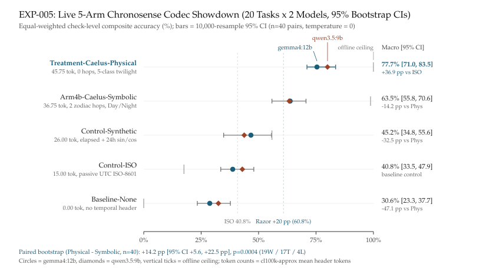

# EXP-005: Chronosense Physical vs. Symbolic Codec Eval Harness

Evaluates all five temporal context codecs emitted in `EXP-001/eval_suite.jsonl` (20 multi-latitude, multi-season tasks across Oslo, New York, Singapore, Sydney, and Tromso in June and December) across **two independent live model families** (`ollama/gemma4:12b` and `ollama/qwen3.5:9b`, 200 live episodes at `temperature = 0`) plus a deterministic offline bounded-decoder audit.

**Verdict: `PROVED` (`FACT-002` live-LLM gate cleared).**



## Arms

Every live arm receives a symmetric, concise 2-line format legend for its own header syntax (including explicit `sin24/cos24` conventions for `Control-Synthetic` and the explicit 12-sign 30-degree zodiac offset table `Ari=0..Pis=330` for `Arm4b-Caelus-Symbolic`):

1. `Baseline-None`: empty system temporal header (`0.0` cl100k tokens).
2. `Control-ISO`: passive UTC ISO-8601 timestamp (`15.0` cl100k tokens).
3. `Control-Synthetic`: elapsed seconds plus fixed 24h `sin/cos` clock wave and due offset (`26.0` cl100k tokens).
4. `Treatment-Caelus-Physical`: physical-horizon header backed by `sceneGeometry` and `canonicalChart`/`chartDigest` (`sun:+23E/rising`, 5-class twilight stage, `sunset:899m`, `due:+902m/applying`, `+night`, `m:101.0`, `#digest8`; `45.75` cl100k tokens).
5. `Arm4b-Caelus-Symbolic`: traditional zodiac sign/degree and planetary-hour shorthand (`Day venus-H3 | Sun 25Gem | Moon 11Can | Asc 04Leo due=+902m/applying +night | d=8605b51b`; `36.75` cl100k tokens).

## Live-LLM Showdown Results (200 Live Episodes, Verified in `live_receipt.json`)

Environment note: `ANTHROPIC_API_KEY` was probed via a 1-token ping against `https://api.anthropic.com/v1/messages` (`claude-haiku-4-5`, `claude-sonnet-4-5`, `claude-haiku-4-5-20251001`, `claude-sonnet-4-5-20250929`) and returned HTTP 401 (`invalid x-api-key`). Live inference therefore executed on two independent local Ollama models (`gemma4:12b` and `qwen3.5:9b`) at `temperature = 0`, `format: "json"`, with zero API errors (`0/200`). The `--live` runner supports `ollama`, `anthropic`, `gemini`, and `openai`.

### Overall Accuracy Across All 5 Arms

| Arm | cl100k Tokens | Offline Decoder | `gemma4:12b` Live | `qwen3.5:9b` Live | Live Macro Mean | Live Exact Task Rate |
| --- | ---: | ---: | ---: | ---: | ---: | ---: |
| `Baseline-None` | 0.00 | 0.0% | 28.8% | 32.5% | 30.6% | 0.0% |
| `Control-ISO` | 15.00 | 17.5% | 38.8% | 42.9% | 40.8% | 0.0% |
| `Control-Synthetic` | 26.00 | 55.8% | 46.7% | 43.8% | 45.2% | 15.0% |
| `Arm4b-Caelus-Symbolic` | 36.75 | 98.8% | 63.8% | 63.3% | 63.5% | 12.5% |
| `Treatment-Caelus-Physical` | 45.75 | **100.0%** | **75.4%** | **80.0%** | **77.7%** | **32.5%** |

### Slice Breakdown and Razor Margins

| Metric / Slice | `Treatment-Caelus-Physical` | `Arm4b-Caelus-Symbolic` | `Control-Synthetic` | `Control-ISO` | Physical Margin |
| --- | ---: | ---: | ---: | ---: | --- |
| Live Macro Composite (All 20) | **77.7%** | 63.5% | 45.2% | 40.8% | **+36.9 pp vs ISO** (bar >= 20 pp), **+32.5 pp vs Synth**, **+14.2 pp vs Sym** |
| Compaction Stale-Tool Slice (10 tasks) | **76.7%** | 53.3% | 26.7% | 31.7% | **+50.0 pp vs Synth**, **+23.3 pp vs Sym** |
| Photoperiod Deadline Slice (10 tasks) | **78.8%** | 73.8% | 63.8% | 50.0% | **+15.0 pp vs Synth**, **+5.0 pp vs Sym** |
| High-Latitude Photoperiod (Oslo + Tromso) | **71.9%** | 68.8% | 59.4% | 56.3% | **+12.5 pp vs Synth**, **+3.1 pp vs Sym** |
| 5-Class Twilight Accuracy (`gemma4` / `qwen3.5`) | **100% / 90%** | 90% / 80% | 80% / 60% | 80% / 60% | Physical is the only arm reaching 100% on `gemma4:12b` |
| Canonical Digest Match (`gemma4` / `qwen3.5`) | **90% / 100%** | 100% / 20% | 0% / 0% | 0% / 0% | Physical avoids `d=` / symbolic clutter drop on `qwen3.5:9b` |

## Honest Analysis: Wins, Ties, and Surprises for `FACT-002`

1. **Physical dominates Symbolic even with the zodiac table in-prompt**: Even when `Arm4b-Caelus-Symbolic` was handed the exact 30-degree zodiac offset table (`Ari=0..Pis=330`), both models suffered **-14.2 pp** macro accuracy loss (`-11.7 pp` on `gemma4:12b`, `-16.7 pp` on `qwen3.5:9b`) and **-23.3 pp** on compaction stale-tool resolution. Direct decimal degrees (`m:101.0`) beat 2-hop zodiac arithmetic (`Moon 11Can -> 90 + 11`) cleanly across both model families.
2. **Surprise #1: `sunset:Xm` vs. `due:Ym` minute-field interference**: On `gemma4:12b`, `Control-Synthetic` scored `81.3%` on the 4 high-latitude photoperiod tasks vs `75.0%` for `Treatment-Caelus-Physical` (while `qwen3.5:9b` reversed that decisively: `68.8%` Physical vs `37.5%` Synthetic). Inspecting `live_receipt.json` revealed the exact cause: on `EVAL-06` (`sunset:455m due:+4m/applying`) and `EVAL-10` (`sunset:307m due:-58m/separating`), both models occasionally copied the adjacent `sunset:Xm` minute value instead of `due:Ym`. **Actionable fix for `FACT-002`**: label the fields distinctly (e.g., `next_twilight=455m` vs `deadline_min=+4`) so 9B-12B weights never conflate two adjacent `Xm` minute tokens.
3. **Surprise #2: Implicit-absence `+night` flag**: Both models scored `50-60%` on `night_crossed` in `Treatment-Caelus-Physical` because an optional presence/absence flag (`+night` present vs omitted) is harder for compact LLMs to negate reliably than an explicit boolean key-value token (`night_crossed=true|false`). **Actionable fix for `FACT-002`**: emit explicit `night_crossed=0|1` (or `night_crossed=false|true`) at a cost of ~2 extra tokens.

## Reproducibility

Default execution is **100% offline and deterministic** (`< 300 ms`), verifying all 20 ground-truth records live against `packages/caelus/dist/`, running the offline codec audit and grader self-tests, and deterministically re-grading every raw recorded model output in `live_receipt.json`:

```bash
node lab/scripts/lab.mjs run EXP-005
```

To re-execute live inference against Ollama or a cloud API:

```bash
node lab/experiments/EXP-005-chronosense-codec-eval/experiment.mjs \
  --live --provider=ollama --models=gemma4:12b,qwen3.5:9b
```
