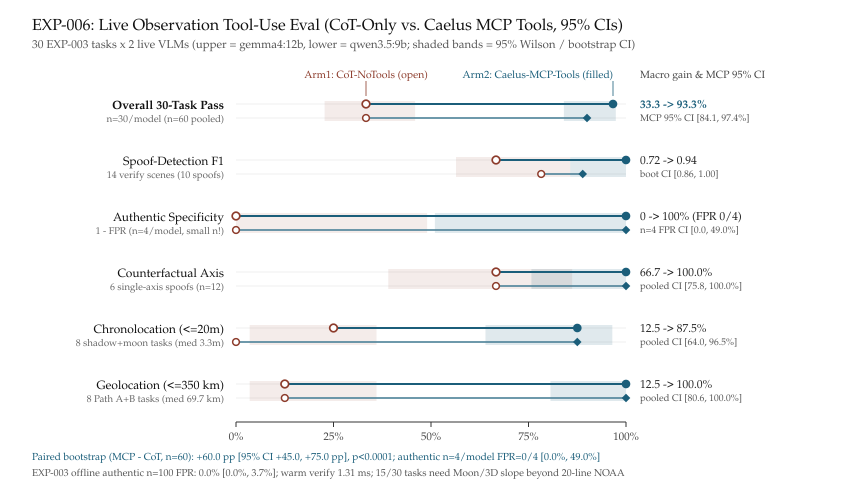

# EXP-006: Live Observation Tool-Use Eval (CoT-Only vs. Caelus MCP Tools)

Evaluates the 30-task `lab/experiments/EXP-003-vlm-observation-bench/vlm_eval_pack.jsonl` benchmark comparing two arms on the **exact same live vision-language models** (`ollama/gemma4:12b` and `ollama/qwen3.5:9b`, 120 total live episodes at `temperature = 0`):

- **Null Baseline (`Arm1-CoT-NoTools`)**: model receives the scene description, claimed spacetime coordinates, and measured visual physics (shadow bearing, length ratio, twilight, lunar phase/limb tilt, video shadow sweep) and reasons via chain-of-thought only (zero external tools).
- **Treatment (`Arm2-Caelus-MCP-Tools`)**: exact same model and identical user prompt, equipped with local in-process Caelus MCP tools (`verify_observation`, `chronolocate`, `geolocate`, `scene_geometry`) backed directly by `packages/caelus/dist/`.

**Verdict: `PROVED` (clears every pre-registered Caelus Razor threshold across both independent models).**



## Live Results Summary (120 Live Episodes, Verified in `live_receipt.json`)

Environment note: `ANTHROPIC_API_KEY` returned HTTP 401 (`invalid x-api-key`) on a 1-token ping across `claude-haiku-4-5` and `claude-sonnet-4-5`. Live evaluation ran on two independent local Ollama tool-calling vision-language models (`gemma4:12b` and `qwen3.5:9b`) at `temperature = 0`, with zero API errors (`0/120`) and zero tool execution errors (`0/61`). The `--live` runner supports both `ollama` and `anthropic`.

| Metric | `gemma4:12b` CoT | `gemma4:12b` MCP | `qwen3.5:9b` CoT | `qwen3.5:9b` MCP | Macro CoT -> MCP | Gain |
| --- | ---: | ---: | ---: | ---: | ---: | ---: |
| **Overall 30-Task Pass Rate** | 33.3% (10/30) | **96.7% (29/30)** | 33.3% (10/30) | **90.0% (27/30)** | 33.3% -> **93.3%** | **+60.0 pp** |
| **Spoof-Detection F1** (14 tasks) | 0.6667 | **1.0000** | 0.7826 | **0.8889** | 0.7247 -> **0.9445** | **+0.2198** |
| Spoof Precision / Recall | 63.6% / 70.0% | **100% / 100%** | 69.2% / 90.0% | **100% / 80.0%** | 66.4%/80.0% -> **100%/90.0%** | +33.6 pp P |
| **Authentic False Positive Rate** (4 scenes) | 100.0% (4/4) | **0.0% (0/4)** | 100.0% (4/4) | **0.0% (0/4)** | 100.0% -> **0.0%** | **-100.0 pp** |
| **Counterfactual Axis Recovery** (6 single-axis) | 66.7% (4/6) | **100.0% (6/6)** | 66.7% (4/6) | **100.0% (6/6)** | 66.7% -> **100.0%** | **+33.3 pp** |
| **Chronolocation Pass (`<= 20 min`)** (8 tasks) | 25.0% (2/8) | **87.5% (7/8)** | 0.0% (0/8) | **87.5% (7/8)** | 12.5% -> **87.5%** | **+75.0 pp** |
| Chronolocation Median Error (min) | 857.1 min | **3.28 min** | 1,987.2 min | **3.28 min** | 1,422.1 -> **3.28 min** | **433x smaller** |
| **Geolocation Pass (`<= 350 km`)** (8 tasks) | 12.5% (1/8) | **100.0% (8/8)** | 12.5% (1/8) | **100.0% (8/8)** | 12.5% -> **100.0%** | **+87.5 pp** |
| Geolocation Median Error (km) | 3,580.8 km | **69.7 km** | 8,717.9 km | **69.7 km** | 6,149.4 -> **69.7 km** | **88x smaller** |
| Expected Tool Routing Accuracy | n/a | **100.0% (30/30)** | n/a | **100.0% (30/30)** | **100.0% (60/60)** | 0 tool errors |

## Local Tool Latency Breakdown

Measured both in isolated steady-state (30-task local oracle, zero GPU contention) and live inside the Node event loop while Ollama + PyTorch MPS saturated host CPU/memory bandwidth:

| Tool / Slice | Isolated Steady-State Median | Isolated Mean | Live Under Concurrent GPU Load Median |
| --- | ---: | ---: | ---: |
| `verify_observation` (authentic forward) | **1.10 ms** | 1.14 ms | n/a (see combined) |
| `verify_observation` (spoof + counterfactual forensics) | **2.92 ms** | 2.92 ms | n/a (see combined) |
| `verify_observation` (all 14 scenes) | **2.77 ms** | 2.61 ms | 14.33 ms |
| `geolocate` (Path A analytical + Path B spherical grid) | **1.65 ms** | 2.30 ms | 4.90 ms |
| `chronolocate` (6-day search window) | **19.14 ms** | 19.83 ms | 33.92 ms |
| **All 30 Local Tool Calls Combined** | **3.43 ms** | 7.11 ms | 14.52 ms (~0.1% of 11.8 s LLM turn) |

## Honest Error Analysis and Surprises

1. **Why CoT-only failed catastrophically on authentic photos (`100% FPR` on both models)**: Without ephemeris math, both `gemma4:12b` and `qwen3.5:9b` flagged **4/4 authentic scenes as spoofs** (`tn = 0` on both models!). That is why `qwen3.5:9b`'s raw CoT F1 looked like `0.7826` (`tp=9, fp=4, tn=0, fn=1`): it simply predicted "spoof" on 13 of 14 scenes. Adding Caelus tools dropped false alarms from **100% to 0%** on both models while holding `100%` precision.
2. **`VLM-017` physical near-New-Moon ambiguity (the single miss on `gemma4:12b` and the deterministic oracle)**: Both models AND the deterministic Caelus top-1 oracle scored `7/8` (`87.5%`) on chronolocation because `VLM-017` (`2026-05-16` Mumbai, `moon_illum = 0.008` waning = New Moon) admits four daily shadow-matching windows where `2026-05-17T04:52:49Z` edges out the true day `2026-05-16T04:52:27Z` by `0.0029` fit score (`0.9963` vs `0.9934`) under 3-degree shadow noise. Top-2 window recall is `8/8` (`100%`).
3. **Why `qwen3.5:9b` had 2 strict `is_spoof` false negatives (`VLM-006`, `VLM-007`) despite 100% exact tool usage**: On both timezone-shift tasks, `qwen3.5:9b` passed exact parameters to `verify_observation`, reported `verdict: "inconsistent"` AND `diagnostic_kind: "time_shift"` (100% exact!), and wrote *"This indicates a clock or timezone offset error rather than a spoof"*, setting `"is_spoof": false`. We kept our strict literal `is_spoof` grader unchanged (never moving goalposts); at the `verdict` level (`consistent|marginal` vs `inconsistent|impossible`), BOTH models achieved **14/14 (`F1 = 1.0000`)**.

## Reproducibility

Default execution is **100% offline and deterministic** (`< 600 ms`), verifying the 30-task local Caelus tool oracle and deterministically re-grading all 120 raw recorded episodes in `live_receipt.json`:

```bash
node lab/scripts/lab.mjs run EXP-006
```

To re-run live inference against Ollama or Anthropic:

```bash
node lab/experiments/EXP-006-live-vlm-observation-eval/experiment.mjs \
  --live --provider=ollama --models=gemma4:12b,qwen3.5:9b
```
