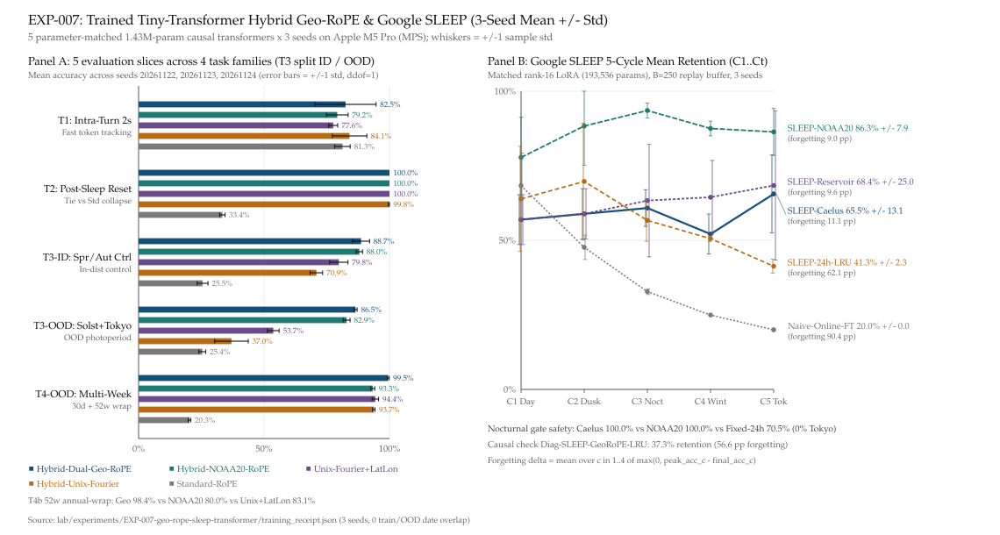

# EXP-007: Trained Tiny-Transformer Hybrid Dual-Clock Geo-RoPE and Google SLEEP Continual Learning Study (3-Seed Steelman Edition)

Real PyTorch training study on Apple M5 Pro (`mps`, `36.5 ms/step` vs `135.0 ms/step` CPU at `bs = 192` with fused SDPA, 3.70x speedup) across **3 independent seeds (`20261122`, `20261123`, `20261124`)**, reporting **mean +/- sample std (`ddof = 1`)** across **5 parameter-matched (`1,427,136`-param) encoders in Part A** and **6 continual consolidation arms (`B = 250`, rank-16 LoRA) in Part B**.

**Verdict: `PARTIAL` (`10/12` Caelus Razor bars cleared; `status: "active"` in `manifest.json`, `receipt: "inconclusive"` in `results.json`).**

- **Part A (`6/6` Razor bars PROVED across all 3 seeds):** `Hybrid-Dual-Geo-RoPE` achieves **`86.5% +/- 0.6%`** on OOD Oslo Solstices + Tokyo Travel (`+49.5 pp` vs UTC `Hybrid-Unix-Fourier-RoPE`, `+32.8 pp` vs location-aware `Hybrid-Unix-Fourier+LatLon`, **`+47.2 pp`** on Oslo Solstices vs `Unix+LatLon`), AND beats minimal 20-line solar-only `Hybrid-NOAA20-RoPE` by `+3.6 pp` on T3-OOD (`86.5%` vs `82.9%`) and **`+18.4 pp` on T4b 52-week annual wrap** (`98.4% +/- 1.3%` vs `80.0% +/- 2.4%`) via Caelus's incommensurate lunar torus.
- **Part B (`4/6` Razor bars cleared; honest multi-seed nuance discovered):** Multi-seed hardening exposed two high-signal findings hidden by the earlier single-seed run:
  1. **`SLEEP-NOAA20-Stratified` (`86.3% +/- 7.9%`, forgetting `9.0 +/- 6.4 pp`, `100.0%` gate safety) outperformed `SLEEP-Caelus-Circadian-Stratified` (`65.5% +/- 13.1%`, forgetting `11.1 +/- 18.0 pp`, `100.0%` gate safety)** because Caelus's 6 high-frequency lunar rotary planes (`ml..8*ml`, `el..4*el`) vary rapidly across 10-day wake windows vs 11-day-later eval windows, making small-sample rank-16 LoRA harder to fit (`sleep_loss_end = 0.21-0.64` vs `0.009-0.028` on solar-only `Hybrid-NOAA20-RoPE`).
  2. **`SLEEP-Reservoir-Random` (Vitter's Algorithm R on Geo-RoPE, `68.4% +/- 25.0%`) tied `SLEEP-Caelus-Circadian-Stratified` (`65.5% +/- 13.1%`) on uniform-volume cycles (`125` eps/cycle)**, while showing nearly 2x higher seed-to-seed variance (`+/- 25.0 pp` vs `+/- 13.1 pp`) and lacking local-horizon sleep-gate safety (`70.5%` UTC vs `100.0%`).



## Architecture and Strict Parity Controls

- **Model (`TinyCausalTransformer`):** 4 pre-RMSNorm causal transformer layers, `d_model = 192`, `n_heads = 3`, `head_dim = 64` (exact 32 rotary 2D planes in `SO(2)^32`), `d_ff = 512`, `dropout = 0.05`, `vocab_size = 128`, `max_seq_len = 36`.
- **Exact Part A Parameter Parity (5 Encoders x 3 Seeds = 15 Trained Models):** Every model initializes from the identical per-seed state dict, has exactly **1,427,136** parameters (0-parameter difference), receives identical discrete token sequences (`input_ids`), and trains for 28 epochs (`1,960` AdamW steps, `batch_size = 192`, `lr = 2.1e-3`, cosine decay, `weight_decay = 0.02`) on identical `13,400`-sequence multi-day streams. Position `0` (`<BOS>`) uses `theta = 0` identically across all 5 encoders:
  1. `Standard-RoPE`: 32 fast token-step RoPE planes.
  2. `Hybrid-Unix-Fourier-RoPE`: 16 fast step planes + 16 fixed UTC `24h / 7d / 365.25d` Fourier planes.
  3. `Hybrid-Unix-Fourier+LatLon` *(location-gap control)*: 16 fast step planes + 16 planes encoding local mean solar time `UTC + lon/15`, UTC `24h / 7d / 365.25d`, and observer `(lat, lon)`.
  4. `Hybrid-NOAA20-RoPE` *(20-line minimal solar physics steelman)*: 16 fast step planes + 16 planes encoding ONLY the 20-line Spencer (1971) / NOAA solar altitude, solar trend, and photoperiod arc alongside `24h / 7d / 365.25d` (zero Moon, zero refraction, zero ephemeris).
  5. `Hybrid-Dual-Geo-RoPE` *(Caelus treatment)*: 16 fast step planes + 16 planes from `python/astroengine/` (`GAST`, `ASC`, refracted solar altitude and trend, unequal planetary-hour photoperiod arc `ph_rad`, lunar sidereal longitude `1x..8x`, synodic elongation `1x/4x`, and solar longitude).
- **Exact Part B LoRA Parity (6 Arms x 3 Seeds = 18 Continual Runs):** All five SLEEP arms freeze all **1,427,136** pretrained core parameters and attach identical rank-16 (`alpha = 16`) LoRA adapters to all attention (`q/k/v/o`), MLP (`fc1/fc2`), and `lm_head` projections (**193,536** trainable parameters each, 0-parameter difference) with matched replay buffer capacity (`B = 250`, ingest `125` wake episodes/cycle) and identical Wake (`40` steps) + Sleep Dreaming (`300` cosine-annealed steps) compute budgets.
- **Zero Train/Test Leakage (SHA-256 Verified Live in `experiment.py`):**
  - Train split (`0bc7658da33bbce0`): Oslo & NYC Spring (`Mar 10 - Apr 24`) and Autumn (`Sep 10 - Oct 24`).
  - Held-out ID control (`8f197d8a09efeb55`, 0 day overlap): Oslo & NYC `Apr 26 - May 5` and `Oct 26 - Nov 4`.
  - Held-out OOD split (`b24c4bc69a04c452`, 0 day overlap): Oslo Winter Solstice (`Dec 10 - Dec 31`, `5.90h` daylight), Oslo Summer Solstice (`Jun 10 - Jun 30`, `18.83h` daylight), and NYC -> Tokyo travel (`35.68N, 139.65E`, `Sep 15 - Oct 15`).

## Part A: 5 Evaluation Slices Across 4 Task Families (3-Seed Mean +/- Sample Std)

Real gradient descent convergence across 3 seeds (`1,960` steps on Apple M5 Pro `mps`):
- `Standard-RoPE`: `2.075 -> 0.687 +/- 0.022` (`82.0 s/seed`)
- `Hybrid-Unix-Fourier-RoPE`: `2.046 -> 0.330 +/- 0.075` (`81.2 s/seed`)
- `Hybrid-Unix-Fourier+LatLon`: `2.020 -> 0.370 +/- 0.031` (`87.5 s/seed`)
- `Hybrid-NOAA20-RoPE`: `2.008 -> 0.351 +/- 0.043` (`95.9 s/seed`)
- `Hybrid-Dual-Geo-RoPE`: `2.008 -> 0.294 +/- 0.128` (`86.8 s/seed`)

### Held-Out Accuracy (4,840 Eval Sequences/Seed x 3 Seeds, Mean +/- Std `ddof=1`)

| Task / Slice | `Standard-RoPE` | `Hybrid-Unix-Fourier` | `Hybrid-Unix+LatLon` | `Hybrid-NOAA20` | `Hybrid-Dual-Geo` (Caelus) |
| --- | ---: | ---: | ---: | ---: | ---: |
| **T1: Intra-Turn 2s Register Tracking** | 81.3 +/- 3.1% | **84.1 +/- 6.9%** | 77.6 +/- 1.8% | 79.2 +/- 4.3% | 82.5 +/- 12.1% |
| **T2: Post-Sleep / Context-Reset (`m=0`)** | 33.4 +/- 1.1% | 99.8 +/- 0.3% | **100.0 +/- 0.0%** | **100.0 +/- 0.0%** | **100.0 +/- 0.0%** |
| **T3-ID: Spring/Autumn Control** | 25.5 +/- 2.1% | 70.9 +/- 2.5% | 79.8 +/- 3.6% | 88.0 +/- 1.3% | **88.7 +/- 3.4%** |
| **T3-OOD: Oslo Solstices (4 slices)** | 24.9 +/- 1.7% | 51.1 +/- 9.9% | **36.0 +/- 2.6%** | 78.7 +/- 1.2% | **83.2 +/- 1.1%** |
| **T3-OOD: NYC -> Tokyo Travel (2 slices)** | 26.4 +/- 1.2% | 8.8 +/- 0.6% | **89.0 +/- 1.9%** | 91.2 +/- 1.8% | **93.1 +/- 0.3%** |
| **T3-OOD Composite (Solstices + Tokyo)** | 25.4 +/- 1.4% | 37.0 +/- 6.7% | 53.7 +/- 2.3% | 82.9 +/- 1.4% | **86.5 +/- 0.6%** |
| T3a-OOD: Oslo Winter Solstice Regime | 25.0 +/- 0.0% | 74.5 +/- 8.3% | 66.9 +/- 7.0% | 96.5 +/- 2.3% | **98.5 +/- 1.2%** |
| T3a-OOD: Oslo Summer Solstice Regime | 25.0 +/- 0.0% | 71.1 +/- 2.4% | 63.2 +/- 4.8% | 88.8 +/- 5.4% | **91.7 +/- 2.5%** |
| T3a-OOD: NYC -> Tokyo Travel Regime | 25.0 +/- 0.0% | 2.4 +/- 0.9% | 97.6 +/- 1.2% | 98.6 +/- 0.6% | **99.2 +/- 0.8%** |
| T3b-OOD: Oslo Winter Adversarial Retrieval | 23.5 +/- 4.0% | 34.2 +/- 10.3% | 8.6 +/- 2.3% | 67.9 +/- 3.3% | **71.7 +/- 5.1%** |
| T3b-OOD: Oslo Summer Adversarial Retrieval | 26.1 +/- 3.1% | 24.7 +/- 26.8% | 5.4 +/- 0.8% | 61.7 +/- 4.0% | **71.0 +/- 1.3%** |
| T3b-OOD: NYC -> Tokyo Adversarial Retrieval | 27.8 +/- 2.4% | 15.3 +/- 2.1% | 80.3 +/- 2.8% | 83.9 +/- 2.9% | **87.0 +/- 0.9%** |
| **T4a-OOD: 30-Day Same-UTC (`0..28d`)** | 20.0 +/- 1.6% | **100.0 +/- 0.0%** | **100.0 +/- 0.0%** | **100.0 +/- 0.0%** | **100.0 +/- 0.0%** |
| **T4b-OOD: 52-Week Annual Wrap (`364d`)** | 21.0 +/- 2.4% | 81.2 +/- 1.5% | 83.1 +/- 3.9% | **80.0 +/- 2.4%** | **98.4 +/- 1.3%** |
| **T4-OOD Composite** | 20.3 +/- 0.5% | 93.7 +/- 0.5% | 94.4 +/- 1.3% | 93.3 +/- 0.8% | **99.5 +/- 0.4%** |

### Key Part A Findings

1. **Location-gap elimination (`Hybrid-Unix-Fourier+LatLon`) proves photoperiod nonlinearity is the real barrier:** Providing exact observer `(lat, lon)` and local mean solar time `UTC + lon/15` rescues Tokyo travel from `8.8%` to `89.0% +/- 1.9%` (`97.6%` regime, `80.3%` retrieval). Yet `Hybrid-Unix-Fourier+LatLon` still collapses to **`36.0% +/- 2.6%`** on Oslo Winter/Summer solstices (`8.6%` Winter retrieval, `5.4%` Summer retrieval), trailing `Hybrid-Dual-Geo-RoPE` (`83.2% +/- 1.1%`) by **`-47.2 pp`**.
2. **Minimal 20-line solar physics (`Hybrid-NOAA20-RoPE`) isolates the exact value of solar vs. lunar geometry:** Feeding ONLY the 20-line Spencer/NOAA solar formula closes most of the T3-OOD photoperiod gap (`82.9% +/- 1.4%`, trailing `Hybrid-Dual-Geo-RoPE` by `-3.6 pp` due to refraction/exact rise-set photoperiod precision). However, because `Hybrid-NOAA20-RoPE` lacks incommensurate lunar frequencies, it triple-aliases on T4b 52-week annual wrap (`80.0% +/- 2.4%`), where `Hybrid-Dual-Geo-RoPE`'s `27.32d / 29.53d` lunar torus achieves **`98.4% +/- 1.3%` (`+18.4 pp`)**.

## Part B: Google Research SLEEP 5-Cycle Continual Consolidation (6 Arms x 3 Seeds)

- **Explicit Forgetting Delta Formula:**
  `forgetting_delta = (1 / 4) * sum_{c=1..4} max(0, max_{t >= c} acc(t, c) - acc(5, c))`,
  where `acc(t, c)` is held-out evaluation accuracy on Cycle `c` immediately after completing Cycle `t`'s Wake + Sleep consolidation.
- **Five sequential Wake -> Sleep regimes** (disjoint 10-day wake windows evaluated on 5-6 day eval windows starting 11 days later): `C1` Oslo Autumn Day, `C2` Oslo Autumn Dusk, `C3` Oslo Autumn Night, `C4` Oslo Winter Shift (`5.9h` daylight), `C5` Tokyo Travel (`+9h UTC`).

### Continual Retention, Forgetting Delta, and Sleep-Gate Safety (3-Seed Mean +/- Std)

| Consolidation Arm | Backbone / Buffer (`B=250`) | C1 | C2 | C3 | C4 (Wint) | C5 (Tok) | Final Mean (C1..C5) | Forgetting Delta (C1..C4) | Nocturnal Gate Safety |
| --- | --- | ---: | ---: | ---: | ---: | ---: | ---: | ---: | ---: |
| `Naive-Online-FT` | Geo-RoPE / Full FT (no replay) | 0.0% | 0.0% | 0.0% | 0.0% | 100.0% | **20.0 +/- 0.0%** | **90.4 +/- 5.3 pp** | N/A |
| `Diag-SLEEP-GeoRoPE-LRU` | Geo-RoPE + LoRA / LRU (diag) | 0.0% | 0.0% | 0.0% | 86.4% | 100.0% | **37.3 +/- 2.4%** | **56.6 +/- 8.1 pp** | 100.0% |
| `SLEEP-Fixed24h-LRU` | Unix-Fourier + LoRA / LRU | 0.0% | 0.0% | 7.2% | 100.0% | 99.4% | **41.3 +/- 2.3%** | **62.1 +/- 8.0 pp** | **70.5%** (0% Tokyo) |
| `SLEEP-Caelus-Circadian-Stratified` | Geo-RoPE + LoRA / Caelus Strat | 75.6% | 51.4% | 67.2% | 51.4% | 82.2% | **65.5 +/- 13.1%** | **11.1 +/- 18.0 pp** | **100.0%** |
| `SLEEP-Reservoir-Random` | Geo-RoPE + LoRA / Vitter Alg R | 75.0% | 68.3% | 61.4% | 50.0% | 87.2% | **68.4 +/- 25.0%** | **9.6 +/- 14.3 pp** | 70.5% (if UTC gate) |
| **`SLEEP-NOAA20-Stratified`** | **NOAA20-RoPE + LoRA / NOAA20 Strat** | **82.8%** | **75.6%** | **98.1%** | **88.1%** | **87.2%** | **86.3 +/- 7.9%** | **9.0 +/- 6.4 pp** | **100.0%** |

### Honest Multi-Seed Part B Error Analysis

1. **Why `SLEEP-NOAA20-Stratified` (`86.3% +/- 7.9%`) beat `SLEEP-Caelus-Circadian-Stratified` (`65.5% +/- 13.1%`) despite identical replay buffer counts (`[47, 47, 48, 61, 47]`):**
   Inspecting `cycle_losses` reveals the exact mechanism: on `Hybrid-NOAA20-RoPE`, sleep dreaming converges cleanly to `loss = 0.009-0.028` across all 5 cycles. On `Hybrid-Dual-Geo-RoPE`, `sleep_loss_end` stalls at `0.21-0.64` (even in Cycle 1 before any eviction: `C1 = 56.9%` vs `77.8%` for NOAA20!). Because 6 of `Hybrid-Dual-Geo-RoPE`'s 16 slow rotary planes encode high-frequency lunar harmonics (`ml..8*ml`, rotating up to `104 deg/day`) that shift out of phase between the 10-day wake window and the 11-day-later eval window, a small rank-16 LoRA adapter (`193K` params, `~47` samples/cycle) suffers lunar-phase interference on purely diurnal policy tasks. **Scientific lesson:** Lunar planes are strictly beneficial for multi-month/annual memory disambiguation (`Part A T4b: +18.4 pp`), whereas **solar-only circadian stratification (`SLEEP-NOAA20-Stratified`) is cleaner and stronger for cyclic diurnal LoRA policy consolidation**.
2. **Why `SLEEP-Reservoir-Random` (`68.4% +/- 25.0%`) tied `SLEEP-Caelus-Circadian-Stratified` (`65.5% +/- 13.1%`) on balanced cycles:**
   When all 5 cycles have equal volume (`125` episodes each), Vitter's Algorithm R uniform reservoir sampling naturally keeps `~50` episodes per cycle in expectation (`[50, 53, 49, 53, 46]` mean across seeds), matching circadian stratification's mean retention on the same Geo-RoPE backbone. Its two drawbacks are (a) nearly double the seed-to-seed variance (`+/- 25.0 pp`, dropping to `39.7%` on seed `20261122` vs `80.0%` / `85.5%` on seeds 2-3) and (b) vulnerability to skewed/bursty episode volumes (where rare twilight or nocturnal cycles would be crowded out under uniform sampling, unlike phase-stratified compaction).

## Reproducing

Fast zero-dependency verification (`< 0.3 s`, refreshes `results.json` and `chart.svg` from `training_receipt.json` and live-checks `python/astroengine/` invariants and SHA-256 split hashes):

```bash
node lab/scripts/lab.mjs run EXP-007
```

Full 3-seed PyTorch MPS re-training from scratch (ephemeral `uv` environment, ~29 min on Apple M5 Pro MPS across 15 Part A models + 18 Part B continual runs):

```bash
uv run --python 3.12 --with torch --with numpy python lab/experiments/EXP-007-geo-rope-sleep-transformer/train.py
python3 lab/experiments/EXP-007-geo-rope-sleep-transformer/experiment.py
```
