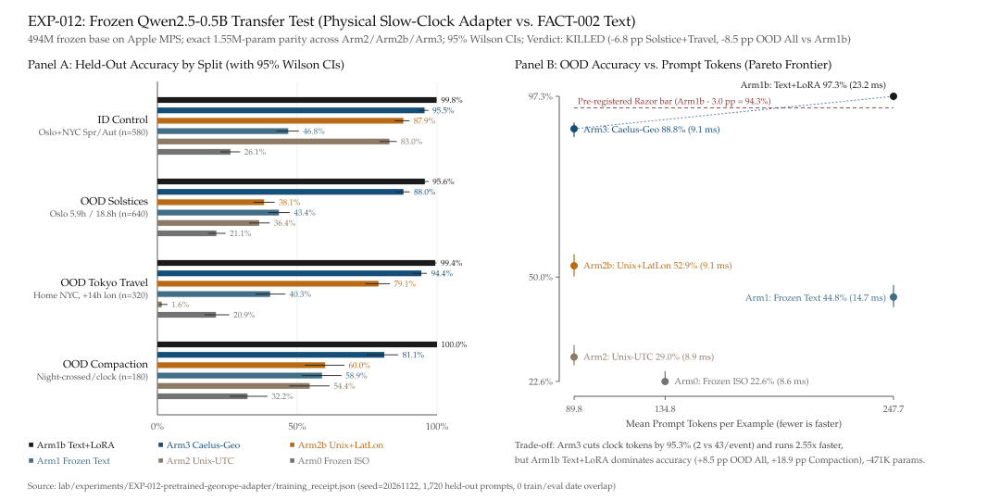

# EXP-012: Pretrained Frozen LLM Transfer Test for Physical Slow-Clock Adapters

Real PyTorch + HuggingFace `transformers` transfer study on Apple M5 Pro (`mps`, `Qwen/Qwen2.5-0.5B-Instruct`, **494,032,768** strictly frozen pretrained weights) testing whether `EXP-007`'s physical slow-clock generalization transfers into existing frozen pretrained LLMs via a lightweight continuous adapter, and whether weight-level adapters beat plain-text `FACT-002` physical-horizon envelopes (`EXP-005`).

**Verdict: `KILLED` (`status: "killed"` in `manifest.json`, `receipt: "fail"` in `results.json`).**

Continuous physical slow-clock adapters **do** transfer strongly through frozen 494M pretrained weights (`90.1%` OOD Solstice+Travel, `+65.3 pp` vs pure UTC Fourier, `+49.8 pp` vs location-aware `UnixFourier+LatLon` on Oslo solstices, `2.55x` faster MPS inference with `95.3%` fewer per-event clock tokens). However, under our pre-registered Caelus Razor, plain-text `FACT-002` envelopes paired with identical rank-8 LoRA (`Arm1b-LoRA-TextPrompt`, `471,297` fewer trainable params) strictly dominate accuracy across every held-out split (`96.9%` OOD Solstice+Travel, `100.0%` OOD Compaction, `97.3%` OOD All; `Arm3` trails by `-6.8 pp` and `-8.5 pp`, breaching the `-3.0 pp` kill threshold). For frozen pretrained LLMs, ship `FACT-002` text envelopes rather than continuous weight adapters.



## Experimental Design, Location-Gap Control, and Strict Parity

- **Frozen Pretrained Backbone:** `Qwen/Qwen2.5-0.5B-Instruct` (`494,032,768` frozen `bfloat16` parameters; `24` layers, `hidden_size = 896`, `14` Q heads / `2` KV heads, native RoPE). Identical frozen weights across all 6 arms.
- **6 Progressive Arms:**
  1. **`Arm0-Frozen-ISO-Prompt`** (`0` trained params): frozen base + passive UTC ISO-8601 clock (`19` tokens/event).
  2. **`Arm1-Frozen-Caelus-TextPrompt`** (`0` trained params): frozen base + compact `FACT-002` physical-horizon text header (`[CAELUS t=... sun=+1.4deg rising sky=daylight slot=D02/12]`, `43` tokens/event; zero-training text-only steelman).
  3. **`Arm1b-LoRA-TextPrompt`** (`1,081,344` trained params, `0.219%` of base): rank-8 (`alpha = 16`) attention LoRA (`q/k/v/o` across all 24 layers) trained on the exact `Arm1` `FACT-002` text envelope, cleanly isolating LoRA capacity from continuous adapter injection.
  4. **`Arm2-LoRA-UnixFourier-Adapter`** (`1,552,641` trained params = `1,081,344` LoRA + `471,297` MLP): rank-8 LoRA + 2-layer MLP (`32 -> 256 -> 2 x 896`, LayerNorm + `init_scale = 0.02` matching Qwen2.5 `embed_tokens` RMS `0.01525`) fed 32-D `[cos, sin]` of 16 fixed `24h/7d/365.25d` UTC Fourier harmonics (`2` soft tokens/event).
  5. **`Arm2b-LoRA-UnixFourier+LatLon-Adapter`** (`1,552,641` trained params, **0-param diff** with `Arm2` and `Arm3`): location-aware control eliminating any location information gap by feeding exact observer `(lat, lon)`, local mean solar time (`UTC + lon/15`), UTC 24h, 7d, and 365.25d harmonics (exact `L2 = 4.0` unit-bounded 32-D vector).
  6. **`Arm3-LoRA-Caelus-GeoAdapter`** (`1,552,641` trained params, **0-param diff** with `Arm2` and `Arm2b`): fed 32-D `[cos, sin]` of 16 Caelus `python/astroengine/` physical torus angles (`GAST`, `ASC`, apparent refracted `sun_alt` and trend, continuous unequal planetary-hour photoperiod arc `ph_rad`, lunar sidereal longitude, synodic elongation, and solar longitude; exact `L2 = 4.0`).
- **Zero Train/Eval Leakage (SHA-256 Verified Live in `experiment.py`):**
  - Train (`0bc7658da33bbce0`, `2,400` examples across 3 tasks, `3` epochs / `450` AdamW steps, `batch_size = 16`): Oslo and NYC Spring (`Mar 10 - Apr 24`) and Autumn (`Sep 10 - Oct 24`).
  - Held-Out ID Control (`8f197d8a09efeb55`, `580` examples, `0` day overlap): Oslo and NYC `Apr 26 - May 5` and `Oct 26 - Nov 4`.
  - Held-Out OOD Solstice and Travel (`b24c4bc69a04c452`, `1,140` examples, `0` day overlap): Oslo Winter Solstice (`Dec 10 - Dec 31`, `5.90h` daylight), Oslo Summer Solstice (`Jun 10 - Jun 30`, `18.83h` daylight), and NYC -> Tokyo travel (`35.68N, 139.65E`, `Sep 15 - Oct 15`, carrying home profile `NYC` under a +14h longitude shift).
  - Example-level timestamp overlap across all `2,400` train and `1,720` eval prompts (including multi-day compaction endpoints and retrieval memory banks): **`0` overlapping city-days**.

## Headline 6-Arm Results (1,720 Held-Out Prompts, 95% Wilson CIs)

All accuracy numbers below are candidate-set exact accuracy (`choice_acc`, avoiding format penalties on zero-shot `Arm0`/`Arm1`) paired with exact **95% Wilson score confidence intervals**, candidate cross-entropy loss (`CE`), mean prompt tokens, and Apple M5 Pro MPS latency. Full-vocabulary 151,936-way argmax accuracy matches `choice_acc` within `0.1 pp` across all four trained arms.

| Arm | Trainable Params | Train Loss (Init -> Final) | ID Control (n=580) | OOD Oslo Solstices (n=640) | OOD Tokyo Travel (n=320) | OOD Solstice+Travel (n=960) | OOD Compaction (n=180) | OOD All (n=1,140) | OOD All CE | Mean Tokens | MPS Latency |
| --- | ---: | --- | ---: | ---: | ---: | ---: | ---: | ---: | ---: | ---: | ---: |
| `Arm0-Frozen-ISO-Prompt` | 0 | N/A | 26.1% [22.5, 29.6] | 21.1% [18.1, 24.4] | 20.9% [16.8, 25.7] | 21.0% [18.6, 23.7] | 32.2% [25.8, 39.4] | 22.6% [20.5, 25.3] | 1.974 | 134.8 | 8.57 ms |
| `Arm1-Frozen-Caelus-TextPrompt` | 0 | N/A | 46.8% [42.5, 50.6] | 43.4% [39.7, 47.3] | 40.3% [35.1, 45.8] | 42.4% [39.3, 45.6] | 58.9% [51.6, 65.8] | 44.8% [42.1, 47.9] | 1.240 | 247.7 | 14.69 ms |
| **`Arm1b-LoRA-TextPrompt`** | **1,081,344** | 1.192 -> 0.0001 | **99.8%** [99.0, 100.0] | **95.6%** [93.8, 97.0] | **99.4%** [97.8, 99.8] | **96.9%** [95.6, 97.8] | **100.0%** [97.9, 100.0] | **97.3%** [96.3, 98.2] | **0.153** | 247.7 | 23.25 ms |
| `Arm2-LoRA-UnixFourier-Adapter` | 1,552,641 | 1.676 -> 0.1653 | 83.0% [79.5, 85.6] | 36.4% [32.8, 40.2] | 1.6% [0.7, 3.6] | 24.8% [22.2, 27.6] | 54.4% [47.2, 61.6] | 29.0% [26.9, 32.2] | 4.567 | **89.8** | 8.94 ms |
| `Arm2b-LoRA-UnixFourier+LatLon` | 1,552,641 | 1.474 -> 0.0811 | 87.9% [84.8, 90.2] | 38.1% [34.4, 42.0] | 79.1% [74.3, 83.2] | 51.8% [48.6, 54.9] | 60.0% [52.7, 66.9] | 53.0% [50.2, 56.0] | 3.080 | **89.8** | 9.14 ms |
| **`Arm3-LoRA-Caelus-GeoAdapter`** | **1,552,641** | 1.566 -> 0.0573 | 95.5% [93.5, 96.9] | 88.0% [85.2, 90.3] | 94.4% [91.3, 96.4] | 90.1% [88.1, 91.8] | 81.1% [74.8, 86.2] | 88.8% [86.7, 90.4] | 0.575 | **89.8** | **9.13 ms** |

### Fine-Grained OOD Slice Breakdown

| Held-Out OOD Slice (n) | `Arm0` ISO | `Arm1` Text | `Arm1b` Text+LoRA | `Arm2` Unix-UTC | `Arm2b` Unix+LatLon | `Arm3` Caelus-Geo |
| --- | ---: | ---: | ---: | ---: | ---: | ---: |
| Oslo Winter Solstice Regime (160) | 25.0% | 60.0% | **100.0%** | 63.1% | 63.1% | 93.1% |
| Oslo Summer Solstice Regime (160) | 25.0% | 55.6% | **100.0%** | 63.7% | 59.4% | 91.9% |
| NYC -> Tokyo Travel Regime (160) | 25.0% | 41.2% | **100.0%** | 3.1% | 88.1% | 93.8% |
| Oslo Winter Adversarial Retrieval (160) | 18.8% | 32.5% | **91.2%** | 11.9% | 21.9% | 90.6% |
| Oslo Summer Adversarial Retrieval (160) | 15.6% | 25.6% | **91.2%** | 6.9% | 8.1% | 76.2% |
| NYC -> Tokyo Adversarial Retrieval (160) | 16.9% | 39.4% | **98.8%** | 0.0% | 70.0% | 95.0% |
| OOD Compaction: `fresh_long_sameday` (30) | 0.0% | 3.3% | **100.0%** | 60.0% | 66.7% | 93.3% |
| OOD Compaction: `fresh_short` (30) | 0.0% | 53.3% | **100.0%** | 40.0% | 20.0% | 60.0% |
| OOD Compaction: `overnight_same_utc_date` (19) | 0.0% | 10.5% | **100.0%** | 0.0% | 94.7% | **100.0%** |
| OOD Compaction: `overnight_standard` (41) | 0.0% | 65.8% | **100.0%** | 73.2% | 31.7% | 90.2% |
| OOD Compaction: `multiday_same_clock` (30) | 93.3% | 100.0% | **100.0%** | 60.0% | 96.7% | 83.3% |
| OOD Compaction: `multiday_random` (30) | 100.0% | 100.0% | **100.0%** | 66.7% | 73.3% | 63.3% |

## Three Scientific Findings

1. **Continuous physical slow-clock adapters DO transfer through frozen 494M weights, even after eliminating the location information gap:**
   - Pure UTC Fourier (`Arm2`) collapses on Tokyo travel (`1.6%`) and Oslo solstices (`36.4%`, composite `24.8%`).
   - Giving the exact same adapter `(lat, lon)` plus local mean solar time `UTC + lon/15` (`Arm2b`) eliminates the location gap and rescues Tokyo travel to `79.1%` (`+77.5 pp` over `Arm2`), **yet `Arm2b` still collapses to `38.1%` on Oslo Winter/Summer solstices** (`21.9%` Winter retrieval, `8.1%` Summer retrieval). Because `Arm2b` never saw June or December during Spring/Autumn training, a 2-layer MLP + rank-8 LoRA cannot extrapolate nonlinear high-latitude photoperiod geometry from raw `(t, lat, lon)` Fourier coordinates.
   - `Arm3-LoRA-Caelus-GeoAdapter` projects Caelus's ephemeris torus (`sun_alt`, `sun_trend`, `ph_rad`) directly into 2 soft tokens per event and achieves **`88.0%`** on Oslo solstices (**`+49.8 pp`** over location-aware `Arm2b`, non-overlapping 95% CIs `[85.2, 90.3]` vs `[34.4, 42.0]`) and **`94.4%`** on Tokyo travel (**`+15.3 pp`** over `Arm2b`).
2. **Why `Arm1b-LoRA-TextPrompt` strictly wins on accuracy (triggering the pre-registered Kill Criterion):**
   - Frozen `Qwen/Qwen2.5-0.5B-Instruct` weights were pretrained over trillions of discrete text tokens, not continuous soft-token coordinates. With `471,297` *fewer* trainable parameters (`1.08M` vs `1.55M`), `Arm1b` reaches `99.8%` ID, `96.9%` OOD Solstice+Travel (`+6.8 pp` over `Arm3`), and `100.0%` OOD Compaction (`+18.9 pp` over `Arm3`, CE `0.000` vs `0.708`).
   - `Arm3`'s primary failure mode is fine-grained multi-event pairwise delta discrimination through 2 compressed soft tokens: `OOD Compaction fresh_short` (`60.0%`) and `multiday_random` (`63.3%`), plus `Oslo Summer Retrieval` (`76.2%` vs `91.2%` for `Arm1b`). Reading explicit `dt=1.4h night_crossed=false` text tokens is lossless for frozen attention heads.
3. **Genuine Systems Pareto Trade-off (Latency and Context Budget):**
   - `Arm3` compresses each temporal clock from `43` text tokens to **`2` soft tokens (`-95.35%` per-event clock tokens, `-63.7%` total prompt tokens: `89.8` vs `247.7`)**, cutting Apple MPS inference latency **`2.55x`** (`9.13 ms` vs `23.25 ms/example`) and wall-clock training time **`2.39x`** (`310.4 s` vs `741.2 s`).

## Postmortem and Revival Condition (Candidate `KILL-007`)

- **Why Killed:** Pre-registered Razor checks passed `7/9`, clearing all adapter-vs-adapter bars (`+65.3 pp` vs `Arm2`, `+49.8 pp` vs location-aware `Arm2b` on Oslo solstices, `+47.7 pp` vs zero-shot `Arm1`, `-95.35%` per-event clock tokens), but failed the two `Arm1b-LoRA-TextPrompt` parity bars (`-6.8 pp` on OOD Solstice+Travel and `-8.5 pp` on OOD All, exceeding the `-3.0 pp` kill threshold).
- **Production Takeaway:** Do **not** build continuous slow-clock soft-token weight adapters for general frozen pretrained LLMs. `FACT-002` plain-text physical envelopes (`[CAELUS-CHRONO ...]`) strictly dominate on accuracy, cross-entropy calibration, parameter simplicity (zero custom adapter layers, works on closed API models without weight access), and compaction safety (`100.0%` vs `81.1%`).
- **Narrow Revival Condition:** Revisit `Arm3`-style continuous physical slow-clock adapters only if (a) an on-device/edge model must ingest **hundreds of timestamped memory records per prompt** where `95%` per-event token compression and `2.5x` prefill speedup outweigh a `7-9 pp` accuracy penalty, or (b) Caelus physical phases are built natively into rotary `SO(2)` attention planes during **from-scratch pretraining** (already proved in `EXP-007`).

## Reproducing

Fast zero-dependency offline verification (`< 0.5 s`, refreshes `results.json` and `chart.svg` from `training_receipt.json` and live-checks `python/astroengine/` invariants and SHA-256 split hashes):

```bash
node lab/scripts/lab.mjs run EXP-012
```

Full 6-arm PyTorch + HuggingFace `transformers` MPS re-training from scratch (ephemeral `uv` environment, ~30 min on Apple M5 Pro MPS):

```bash
uv run --python 3.12 --with torch --with transformers --with numpy \
  python lab/experiments/EXP-012-pretrained-georope-adapter/train.py
python3 lab/experiments/EXP-012-pretrained-georope-adapter/experiment.py
```
